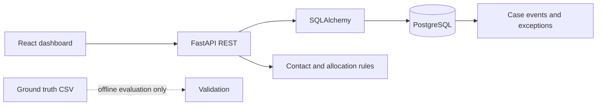

# Architecture

Customer 1:N Account; Account 1:N Loan; Loan 1:N Installment and Snapshot; Customer 1:N ContactPreference; Loan 1:N CollectionCase; Case 1:N ContactAttempt, PromiseToPay and CaseEvent; Account 1:N Payment; Payment N:M Installment via PaymentAllocation; Promise N:M Payment via PromisePaymentAllocation; Exception may reference case/loan.

Design choices: NUMERIC monetary columns; timezone-aware event timestamps; IANA timezone per contact preference; bridge tables for allocations; event history for case status; ground-truth kept separate from operational features. Prototype limitations include no authentication, migrations, pagination or production monitoring.
